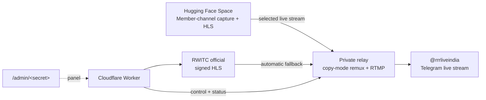

# RRR INDIA FREE LIVE RACE — relay setup

## Final architecture

Three pieces, one stream:

1. **Hugging Face Space** — capture and protected HLS for live Telegram
   broadcasts visible to the authorized account. Unmodified upstream `tgtv`
   plus MediaMTX is pinned to `69ddb30949cdeb604820a5d324e01b1b76a7b79a`;
   MediaMTX is `1.19.2`. The active playlist identifies live channels and
   stable stream IDs. Repo: `Bahama/tgtv-turbo-trial`.
2. **Private relay** — restream. `relay_engine/daemon.py` pulls the selected
   channel's HLS playlist, remuxes with `-c copy`, and pushes RTMP to the
   configured RRR destination. Chat `4347395930` is excluded as a source.
   Runs on Render Free: 0.1 CPU / 512 MB is enough because stream-copy is
   network-bound, not CPU-bound.
3. **Cloudflare Worker** — control plane and public site. `rwitc-racing`
   serves the RWITC official stream, race fixtures, and an admin panel.



### Why HF cannot publish the Telegram stream directly

Hugging Face Spaces allow egress only on ports **80, 443, and 8080**.
Telegram's RTMP ingest is port **1935**. The Space therefore captures and
serves, and the thin private relay performs the RTMP push. HF might be
UPnP-capable but **does not** imply privileged egress: RTMP remains blocked.
This is the single architectural constraint.

### Selecting and restreaming member-channel broadcasts

The private admin panel lists only member-channel broadcasts confirmed live by
Hugging Face. Its `/p/<PATH_SECRET>/playlist.m3u` is the live source of truth;
the relay refreshes that liveness on every monitor poll while Telegram
membership discovery remains interval-based. The relay maps each chat ID to
upstream tgtv's stable `sha256(str(chat_id))[:12]` stream ID. The RRR output
chat `4347395930` is always excluded.

Open **Preview stream** to view that exact stream, then click **Start restream**.
This explicit Start also works when `auto_start` is off. Pause and Stop remain
overrides. Selecting **Automatic** clears the manual source and returns to the
configured automatic source behavior.

The existing output invite remains
`https://t.me/+-UyRaC_GVSw3NTU1`; `RELAY_OUTPUT_CHAT_ID=4347395930` is only an
exclusion value and does not replace the invite.

`telegram.py` resolves the target channel, verifies creator or `manage_call`
rights, calls `GetGroupCallStreamRtmpUrl`, and creates an RTMP call only if
none exists. An existing non-RTMP or scheduled call is never replaced, and only
a call this relay created is discarded on stop.

A channel holds one call at a time, so an ended or non-RTMP call left behind by
an earlier broadcast blocks every new one; Telegram reported it as
`rtmp=False, participants=0`. The status document names that condition, and the
panel then offers **Clear ended output call**, which discards a call only when
it has no participants and no RTMP stream. That action is always operator
initiated: a live or scheduled broadcast is never replaced automatically.

### Capture routes the panel depends on

Both **Preview stream** and **Start restream** require the Space to serve
`/p/<PATH_SECRET>/watch/<stream_id>` and
`/p/<PATH_SECRET>/streams/<stream_id>/play.m3u8`. A deployment that answers 404
for those routes can still list channels in `playlist.m3u`, so a live row does
not prove that its media is being captured. Verify the two routes before
treating a member-channel failure as a relay fault.

### Liveness is read from the playlist, never by requesting a stream

Requesting a stream URL makes the capture host start ingesting it, and every
ingest needs a Telegram authorization export to the stream's datacenter, which
Telegram flood limits. Polling the pinned stream URL for liveness therefore kept
that export exhausted and the broadcast never started: tgtv logged
`stream DC 5 not ready until …` and answered `503 ingest start failed` within
about two seconds of each attempt.

The relay now decides pinned availability from `playlist.m3u` membership, which
is a discovery document, and a failing media process backs off from 3 seconds to
a 60-second cap instead of retrying every 3 seconds. The player page still
requests its stream directly, so leaving a preview open retries the upstream.

### Admin panel
Secret URL, not a searchable path:

```
https://rwitc-racing.kristopherreed0227-1etlk.workers.dev/admin/<ADMIN_SECRET>
```

`ADMIN_SECRET` is a Cloudflare secret, not in the repository, and never in
chat. The page is `noindex` and self-contained. It shows member-channel names,
live state, Hugging Face previews, the selected source, race fixtures, and
play/pause/stop/auto-start controls. The private page may expose the
PATH_SECRET-protected preview URL, but sends no referrer to Hugging Face. It
does not expose the RTMP host, relay origin, or relay bearer token.

### Admin control never waits behind a media cycle

`reconcile()` holds `self.lock` across its whole body, including slow
`to_thread` work such as waiting on FFmpeg. An admin `pause` that queued on
that same lock would not land until the media cycle finished, which could
look like a hung dashboard press. `control()` therefore takes a separate
`control_lock`, and both locks are only ever acquired in that order, so
pause, resume, stop, force, and auto-start answer immediately even while
playout is busy. Covered by `relay_engine/test_control_latency.py`.

### Durable controls

Controls persist in D1 `relay_state` (`paused`, `forced`,
`auto_start`, `selected_chat_id`). Pause, source selection, and auto-start
survive restart and Render's ephemeral disk. A failed durable write never
reports a successful change, and unavailable durable state fails closed
instead of defaulting to unpaused.

### Worker cron

`*/10 * * * *` triggers the deployed Worker (visible in
`wrangler deploy` output as `schedule: */10 * * * *`). The scheduled handler
requests the relay `/healthz`, which is the inbound traffic that stops Render
Free from spinning down after 15 idle minutes; without it the relay could not
notice a live Turbo broadcast. The ping carries no credentials and the endpoint
reports configuration presence only. It does not keep a Hugging Face Space
awake, and a relay that is already asleep takes one request to wake.

## Retired capture deployment

The original Render Free capture service `tgtv-turbo-live`
(`https://tgtv-turbo-live.onrender.com`) was deleted. Its URL returns 404 and
the Render workspace shows "No active services". Do not reuse that service:
HF owns the capture role now, and the relay replaces it.

Turbo capture uses **unmodified [tgtv](https://github.com/aleskxyz/tgtv)**,
not the custom Python capture module. The deployment wrapper is
https://github.com/NerdBaba/tgtv-render, mirrored in `tgtv_render/`.
It runs tgtv and MediaMTX in one Docker web service on Render's Free plan.
Upstream source is pinned to `69ddb30949cdeb604820a5d324e01b1b76a7b79a`;
MediaMTX is `1.19.2`.

- Service: `https://tgtv-turbo-live.onrender.com`
- Health: `/health`
- Turbo HLS: `/p/<PATH_SECRET>/streams/2631340b81ae/play.m3u8`
- Available live channels: `/p/<PATH_SECRET>/playlist.m3u`
- Render dashboard:
  `https://dashboard.render.com/web/srv-db693gtckfvc73cjk2c0`

Open the Turbo HLS URL in VLC or another HLS player when the channel is live.
The stream identifier is derived from the chat ID, so the URL stays the same
across broadcasts. Requests start ingest on demand. No substitute replay is
used when the channel is offline.

Render environment secrets contain `TELEGRAM_API_ID`, `TELEGRAM_API_HASH`,
`SESSION_JSON_B64`, `PATH_SECRET`, and `MEDIAMTX_HLS_CDN_SECRET`.
The authorized session is restored to a private writable file at startup,
including after Render discards the local filesystem. `FULL_SCAN_INTERVAL_SECONDS`
is set to `120`. No API hash or session is included in the image or repository.
The API keys identify the app; an authorized account that can view the channel
is also required.

**Never run the same session locally and on Render at the same time.**
Telegram can permanently invalidate it with `AUTH_KEY_DUPLICATED`.
Stop the existing service before moving an authorization to another host.
For a new login, run upstream `tgtv login` in an isolated session directory,
finish OTP/2FA in the local terminal, exit that client, then replace
`SESSION_JSON_B64` in Render. Do not publish the session or paste OTPs into chat.

Render Free sleeps after 15 minutes without inbound traffic; opening the URL
wakes it, with cold-start and ingest delay. It cannot continuously monitor
Telegram while asleep. Free CPU, bandwidth quotas, and suspension policies
still apply. No keep-awake pings or paid upgrades are configured.
See https://render.com/docs/free.

### Hosted playback verification and unresolved limit

On 2026-10-12, the hosted Turbo HLS decoded 450 frames / 15 seconds of
1280×720 H.264 video at 30 fps, plus 48 kHz stereo AAC audio. A decoded frame
showed the current Hyderabad race broadcast. However, that decode took
88.79 seconds elapsed, with repeated waits for new HLS segments:
**the Free deployment delivers media but is not smooth real-time playback.**

The pinned upstream remuxer always applies video padding to MP4/MOV parts
and encodes them with `libx264 -preset veryfast`; the channel-logo overlay
also uses that encoding path. Its configuration exposes no switch to disable
this work. CPU capacity is the leading performance explanation, not a
confirmed CPU measurement. Continuous playback requires either a measured
upstream optimization or a host with sufficient resources. Neither a paid
upgrade nor a source fork has been authorized or applied.


## Hugging Face Gradio deployment: CPU stream, optional GPU preview

The active Space is https://huggingface.co/spaces/Bahama/tgtv-turbo-trial.
Its public repository contains `tgtv_hf/app.py`, `tgtv_hf/preview.py`,
unmodified pinned tgtv and MediaMTX binaries, corresponding tgtv source,
and redistribution licenses.

Render was suspended and its public endpoint returned the suspended-service
503 page before the saved Telegram session was added as a Space secret.
No local Telegram client was running. Never resume Render while the Space
uses the same authorization.

Live streaming stays on CPU. The optional preview captures one video frame
with FFmpeg, then performs real CUDA interpolation for a 640×360 thumbnail.
The GPU decorator covers only that image-processing operation. Allocation
or quota errors are caught outside the decorator and produce a real CPU
thumbnail instead; HLS endpoints and relay processes never depend on GPU
allocation. The Gradio launcher performs ZeroGPU's startup handshake.

The selected-channel player is
`/p/<PATH_SECRET>/watch/<stream_id>`. It requests the matching
`/p/<PATH_SECRET>/streams/<stream_id>/play.m3u8`; the legacy `/watch` route
continues to open Turbo's stable stream ID. The relay reads
`/p/<PATH_SECRET>/playlist.m3u` to determine which member channels are live.
The playback token remains private, and the player sends no referrer.

The hosted revision started successfully, `/health` returned 200, the
Turbo master advertised 1280×720 H.264 at 30 fps plus AAC, and the browser
displayed the current Hyderabad broadcast. The optional preview returned
and displayed a real GPU-processed 640×360 frame while CPU playback ran.
Some browser buffering was observed; startup is not proof of smooth uptime.

The controlled quota-denial regression passed using actual CPU image
processing. A real FFmpeg capture smoke also passed on a machine without
CUDA. A live host's GPU quota has not been deliberately exhausted.

Playback URL:
`https://bahama-tgtv-turbo-trial.hf.space/p/<PATH_SECRET>/streams/2631340b81ae/play.m3u8`
The playback token is a generated relay password stored in the Space secret
`PATH_SECRET`, not a token extracted from Telegram. The stream ID is derived
from Turbo's channel ID and remains stable across broadcasts; the URL changes
if the Space address or playback token changes. Turbo must still be live.

The Space currently reports `gcTimeout: 172800` (48 hours). A cron service
can monitor `https://bahama-tgtv-turbo-trial.hf.space/health` without a token.
Periodic requests may prevent inactivity sleep, but this is not a documented
always-on guarantee and does not prevent restarts, suspensions, or GPU quota
exhaustion. No cron job or artificial keep-alive traffic has been configured.
Official lifecycle controls: https://huggingface.co/docs/hub/spaces-gpus#sleep-time.


## Current implementation and limits

The relay serves playable HLS, supervises FFmpeg, and persists the selected
member-channel source in D1. Discovery reads the Hugging Face live playlist;
the admin preview and Start action route to that channel's stable HLS stream,
then publish the same playout to the configured RTMP destination. The dashboard
is at `http://127.0.0.1:8800/` while the daemon runs.

**A channel invite or HLS link is not a publishing credential.** To broadcast in
Telegram, use either the channel's RTMP server/key or an authorized Telegram user
session with creator/manage-call rights. A Bot API token cannot create a native
channel live stream.

The custom relay's Turbo preview is detection only. Its Python media-capture
work is not used for the hosted Turbo stream. Capture, call discovery,
rejoining, remuxing, and HLS delivery are handled by upstream tgtv in the
Render deployment above.

Running from source needs `ffmpeg`, a C compiler, `pkg-config`, and FFmpeg
development libraries (`libavformat`, `libavcodec`, `libavutil`). On macOS:
`brew install ffmpeg pkg-config` and install the Xcode command-line tools if
`cc` is absent. The Docker image includes FFmpeg and a precompiled sender.
The sender receives its destination/key over a private stdin pipe. Hosting
secrets are stripped from media/compiler child environments and never logged.

## Render Free hosted trial

This is a best-effort trial, not uninterrupted production hosting. The service
can sleep after 15 minutes without inbound traffic; outbound RTMP alone does
not keep it awake. Render may restart or suspend free services. The Hobby
workspace currently includes 5 GB/month outbound bandwidth, shared with other
services. Excess usage is billed if a payment method exists, or services are
suspended otherwise. There are no keep-awake pings or automatic paid upgrades.
See https://render.com/docs/free and https://render.com/pricing.

1. Sign in to Render and connect the private deployment repository:
   https://github.com/NerdBaba/tintustream. Grant access to this repository only.
2. Create a Blueprint from its `render.yaml`. It explicitly selects a single
   **Free** Docker web service in Singapore. The dashboard provides HTTPS.
3. Enter the prompted secret settings in Render itself:
   - `ADMIN_TOKEN`: the existing private `admin_token` from `rrr_config.json`.
     It must match the Cloudflare Worker's token, not a new random value.
   - `RTMP_URL`: the channel's Telegram Server URL.
   - `RTMP_KEY`: its Stream Key.
4. Deploy. Render supplies `PORT`; the daemon listens on `0.0.0.0`, serves
   `/healthz`, and starts from environment settings without writing credentials
   into a config file. Open the service URL and connect with the admin token.
5. Activate **Live Stream → Stream With…** in Telegram and verify as a viewer.
   RTMP credentials allow publishing but do not create a new native Telegram
   call automatically.

The Blueprint sets `RELAY_MEDIA_MODE=copy`: H.264/AAC are remuxed without
re-encoding or changing frame rate. This is substantially lighter than the
local default `transcode` mode. HLS output remains temporary.

Pause/source settings use the protected Cloudflare `/api/relay-state` endpoint
and D1, not Render's ephemeral disk. A new container reloads those settings
before starting media. A missing token or unavailable state backend fails
closed; a failed durable write does not report a successful control change.
The fresh-database schema is `worker/src/mtproto/schema.sql`. Existing D1
databases add `selected_chat_id` with
`worker/migrations/0001_add_selected_chat_id.sql`.
`RELAY_INPUT_URL` remains the protected HF playback URL template; the relay
replaces its stream ID with the selected channel's stable TGTV ID.
`RELAY_CHANNEL` remains `https://t.me/+-UyRaC_GVSw3NTU1`; output chat
`4347395930` is configured separately only for source exclusion.

After Render assigns the service URL, optionally set the Worker's
`RELAY_ORIGIN` to that HTTPS origin and `RELAY_TOKEN` to the same admin token.
Then `/live` can proxy hosted playout. No origin is fabricated before deployment.
The default Render URL serves the dashboard directly.


## Fastest Telegram broadcast: RTMP credentials

1. Open the target channel in Telegram. Choose **Live Stream → Stream With…**.
2. Copy its **Server URL** and **Stream Key** into your local, private
   `rrr_config.json` as `rtmp_url` and `rtmp_key`. Do not put the key in chat,
   source code, screenshots, or a public URL.
3. Start the Telegram stream in that dialog, then run the daemon:

   ```bash
   ./.venv/bin/python -m relay_engine.daemon --config rrr_config.json
   ```

4. Open the dashboard and enter `admin_token` from the same config. Check the
   live preview and open the channel as a viewer to verify the Telegram output.

If the daemon is already running, restart it after editing configuration;
secrets are loaded at process startup, not hot-reloaded.

The daemon creates a private config with a random admin token if none exists.
It does not invent publishing credentials. Configuration files should have
permissions `0600`; runtime state and media are excluded from version control.

Direct RTMP publishing does not need a Telegram API login. Without a user
session it cannot post channel announcements or end a manually created call.
**Stop output** stops FFmpeg; end a manually created call in Telegram itself.
The dashboard distinguishes a running publishing process from proof that a
Telegram viewer received video.

## User-session publishing and automatic channel posting

1. Create an API application at https://my.telegram.org under **API development
   tools**. Obtain its API id and API hash.
2. Install Telethon and log in locally:

   ```bash
   python3 -m venv .venv
   ./.venv/bin/pip install telethon
   ./.venv/bin/python telegram_login.py \
       --api-id YOUR_API_ID \
       --api-hash YOUR_API_HASH \
       --channels https://t.me/+-UyRaC_GVSw3NTU1
   ```

   Enter the phone number, OTP, and any two-step password in your own terminal.
   Do not send them in chat. The script connects before checking authorization
   and reuses an already authorized session without asking for a new code.
3. Set `tg_api_id` and `tg_api_hash` in the private relay config, or use
   `TG_API_ID` and `TG_API_HASH` in the daemon's environment. Optional config:
   `session` (default `rrr_live`) and `channel` (default the private invite above).
4. Run the daemon. It resolves the already-joined channel, verifies creator or
   `manage_call` rights, obtains genuine RTMP credentials, and creates an RTMP
   call only if none exists. An existing non-RTMP or scheduled call is not
   replaced.

Channel announcements additionally require permission to post messages.
Publishing can work with manage-call rights even when posting is refused.

Private invite hashes are opaque: they do **not** encode a channel id and access
hash. No automatic channel join is attempted. If an invite expired, resolution
can use an exact exported-invite match from existing admin-channel dialogues;
otherwise supply the already-known numeric channel id or a current invite.
Titles are not guessed. Expired-invite recovery reads dialogue metadata; normal
resolution requests the explicitly configured channel only.

Session files grant account-level authority and can expire or be revoked.
Telethon does not turn them into channel-scoped credentials. Keep them private,
use a dedicated account if preferred, and revoke unused sessions in Telegram
**Settings → Devices**.

## Controls and source behavior

- **Start / resume:** enable automatic output.
- **Pause:** stop media output without replacing or ending an existing call.
- **Stop output:** stop media; with a session, discard only a call created by
  this publisher instance. Calls created manually or by another process remain.
- **Force RWITC / Automatic:** persist the selection and immediately recheck.
- **Force Turbo:** records the choice, but remains unavailable until native
  media capture is implemented from authenticated evidence.

The primary source is selected by **fresh, readable media**, not merely an
`active` record or today's `stream_url`. An empty newest record does not hide an
older published player when that record is still available from discovery.
Player HTML resolves the current master/token; no CDN token is hardcoded.
Stale, future-dated, ended, malformed, or unreadable feeds are unavailable.
Neither source available means no output. Replays are not live substitutes.

The retired `stream_watch.py` exploratory probe is replaced by the daemon,
`relay_engine/turbo_events.py`, and the real publisher.

## Worker playout and optional edge login

The existing public HLS endpoint is:

`https://rwitc-racing.kristopherreed0227-1etlk.workers.dev/api/live`

The Worker adds `/live`, `/api/fixtures`, `/api/stream-status`, protected
`/api/relay-state`, `/telegram-login`, and bearer-protected `/telegram/*`
authentication routes. See `worker/README.md` for D1/secrets/deployment
instructions. This edge session is separate from a local Telethon session:
edge login alone does not authorize local channel publishing.

To pull daemon playout from the edge, set `RELAY_ORIGIN` to a reachable HTTPS
origin and `RELAY_TOKEN` to the local admin token. The default loopback daemon
is not reachable from a deployed Worker. Do not expose the dashboard without
TLS/access protection. A reachable daemon's paused, unavailable, or starting
state returns 503 instead of bypassing its decision with official fallback.

## Verification

```bash
./.venv/bin/python -m relay_engine.test_offline
./.venv/bin/python -m unittest relay_engine.test_telegram relay_engine.test_daemon relay_engine.test_publishing relay_engine.test_state
```

The recovery tests replay isolated generated media through actual FFmpeg HLS,
kill or suspend the owned media process, verify restarted playback, and prove
a pause survives daemon restart. Missing initial output also triggers recovery
after 20 seconds. Publishing tests receive real RTMP H.264/AAC or video-only
media, decode the received streams, and check the sender's process arguments
for key exposure. These tests never touch a user account or an external feed.
